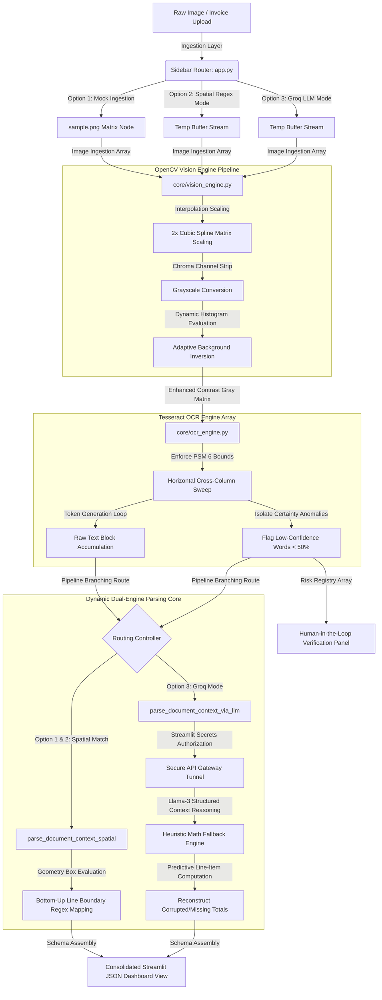

# Enterprise Intelligent Document Processing (IDP) Engine

An enterprise-grade, microservice-ready **Intelligent Document Processing (IDP)** pipeline engineered in Python. This repository combines advanced computer vision text enhancement pipelines, raw Optical Character Recognition (OCR) matrix extraction arrays, spatial regular expression trees, and advanced LLM semantic parsing via Groq Cloud API to convert unstructured, noisy document images into schema-compliant, structured JSON datasets.

---

## 🏗️ System Architecture & Workflow Pipeline

The layout below illustrates how data transforms as it flows sequentially through the system matrix segments, branching dynamically into either Spatial Regex Parsing or the Heuristic Math LLM Engine depending on your selected Pipeline Configuration:



---

## 🚀 Key Architectural Features

*   **Adaptive Computer Vision Tier:** Leverages **OpenCV** to automate matrix interpolation (Cubic Splines), grayscale channel separation, and automated background binarisation to maximize text structural clarity before downstream translation.
*   **Context-Preserving OCR Infrastructure:** Utilises structural Page Segmentation Modes (`--psm 6`) via **Tesseract** to retain geometric cross-column coordinates across fragmented data tables and invoices.
*   **Dual-Route Parsing Architecture:** 
    *   **Deterministic Spatial Parser:** Uses bounding box geometry mapping coordinates (`left`, `top`, `width`, `height`) to extract critical financial indicators across complex global and Indian Rupee layouts.
    *   **Cognitive LLM Parser:** Leverages Groq Cloud API's deterministic JSON Mode to read noisy OCR text contextually. Includes an automated mathematical fallback engine that programmatically recalculates broken total values using up-table line items.
*   **Human-in-the-Loop Risk Profiling:** Programmatically maps word-level confidence indicators under 50% to automatically flag high-risk translations for manual review.
*   **Interactive Streamlit Control Panel:** Features a responsive layout hosting a configuration sidebar interface, clean triple-mode toggle components, and collapsible, 4-space indented code blocks using custom JSON syntax configurations.

---

## 🛠️ Technology Stack & Dependencies

*   **Language Layer:** Python 3.10+ (Fully validated on Python 3.14 environments)
*   **Vision Subsystem:** OpenCV (`opencv-python-headless`)
*   **OCR Matrix Architecture:** Tesseract OCR Engine Engine (`pytesseract`)
*   **Generative AI Gateway:** Groq Python SDK Client Core (`groq`)
*   **Web Portal Architecture:** Streamlit Cloud Framework Core
*   **Data Layouts:** Native JSON, Advanced Regex Systems (`re`)

---

## 📦 Project Layout Overview

```text
enterprise-intelligent-document-processing/
│
├── .streamlit/
│   └── config.toml            # UI Theme & Display Properties
│   └── secrets.toml           # Encrypted API Authorization Tokens (Local Sandbox)
│
├── core/                      # System Engine Submodules
│   ├── __init__.py            # Module Registration Node
│   ├── vision_engine.py       # OpenCV Matrix Operations
│   ├── ocr_engine.py          # Tesseract String Translations
│   └── data_parser.py         # Advanced Document Regex & Groq LLM Logic
│
├── app.py                     # Streamlit Main Dashboard Gateway
├── sample.png                 # Mock Invoice Reference Matrix
├── requirements.txt           # Python Package Manifest
├── packages.txt               # OS Binary Component Flags (tesseract-ocr)
└── README.md                  # Project System Documentation
```

---

## ⚙️ Local Installation & Sandbox Launch

### 1. Provision Operating System Engine (Ubuntu/Debian)
The underlying OCR infrastructure requires direct system binaries to evaluate image pixel locations:
```bash
sudo apt-get update
sudo apt-get install tesseract-ocr -y
```

### 2. Configure Virtual Environment & Packages
```bash
# Clone the repository node
git clone https://github.com
cd enterprise-intelligent-document-processing

# Instantiate independent environment sandbox
python3 -m venv venv
source venv/bin/activate

# Install component runtime libraries
pip install -r requirements.txt
```

### 3. Add API Authentication Credentials
Create a local file inside your project structure at `.streamlit/secrets.toml` and inject your active Groq Cloud key matching this layout:
```toml
GROQ_API_KEY = "gsk_yOuRGroQApiKeyHerE..."
```

### 4. Start the Web Server Locally
```bash
streamlit run app.py
```

---
💡 *Engineered with automated data processing logic to bridge the gap between unstructured, degraded image assets and structured database records.*
